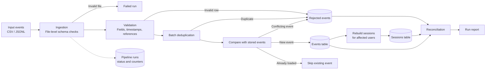

# Clickstream Sessionization Pipeline

A data engineering pipeline that transforms raw clickstream and application events into meaningful user sessions.

In real-world applications, user activity does not always arrive in the order it happened. Events can be delayed, duplicated, incomplete, or received more than once. Processing this data reliably requires more than simply sorting records and grouping them together.

This project addresses that challenge through **event-time-based sessionization**. It validates incoming records, handles duplicate and out-of-order events, stores accepted data in SQLite, and rebuilds sessions when new events affect a user's activity history.

The pipeline also includes reconciliation checks, failure handling, reproducible test data, and performance benchmarking to make its behaviour easier to verify.

## Highlights

- **Event-time sessionization:** Creates a new session when the time gap between consecutive events exceeds the configured threshold.
- **Data validation:** Checks incoming records and quarantines invalid rows with a clear rejection reason.
- **Duplicate handling:** Distinguishes identical duplicate events from conflicting records.
- **Late-arriving events:** Recalculates sessions for affected users when new events change their activity history.
- **Safe reruns:** Prevents previously processed events from being inserted again.
- **Transaction safety:** Uses database transactions to avoid partially applied data changes.
- **Reconciliation:** Checks consistency between stored events, sessions, and run-level counts.
- **Performance testing:** Includes a reproducible 100,000-row dataset and an incremental-rebuild experiment.

## Technology Stack

- Python 3.9+
- SQLite
- SQL
- Python standard library
- `unittest` for automated tests
- `pytest` (optional)

The pipeline's runtime uses Python's standard library and SQLite. No external database server or third-party runtime dependency is required.

---

## 1. Quick Start

### Prerequisites

- Python 3.9 or later
- Git (to clone the repository)

Clone the repository from its GitHub URL and open the project directory.

### Windows PowerShell

Create and activate a virtual environment:

```powershell
python -m venv .venv
.venv\Scripts\Activate.ps1
```

If PowerShell blocks activation, run:

```powershell
Set-ExecutionPolicy -Scope Process -ExecutionPolicy Bypass
.venv\Scripts\Activate.ps1
```

Install the project and optional test dependencies:

```powershell
python -m pip install -e ".[test]"
```

The editable installation is useful for development and installs the optional test tools. The pipeline itself uses the standard library.

### macOS / Linux

```bash
python3 -m venv .venv
source .venv/bin/activate
python -m pip install -e ".[test]"
```

### Run the tests

The standard-library test suite can be executed without pytest:

```bash
python -m unittest discover -v
```

Alternatively, if pytest is installed:

```bash
python -m pytest -v
```

### Process the sample dataset

Run the pipeline using the supplied sample events and user reference file:

```bash
python -m pipeline run --input data/sample/events.csv --users data/sample/users.csv --expected-dir data/expected/sample
```

Run example analytical queries against the resulting database:

```bash
python -m pipeline queries
```

### Generate and process a larger dataset

Generate 100,000 synthetic event rows along with their expected outputs:

```bash
python -m pipeline generate --rows 100000 --out-dir data/large --expected-dir data/expected/large
```

Process the generated dataset:

```bash
python -m pipeline run --input data/large/events.csv --users data/large/users.csv --db out/large.db --expected-dir data/expected/large
```

Run the benchmark:

```bash
python -m pipeline benchmark --rows 100000 --output docs/PERFORMANCE.md
```

### Verify safe reruns

Run the same input twice:

```bash
python -m pipeline run --input data/sample/events.csv --users data/sample/users.csv
python -m pipeline run --input data/sample/events.csv --users data/sample/users.csv
```

On the second run, previously stored identical events are skipped. No new events should be inserted, and sessions should not need rebuilding.

### Output files

By default, the pipeline writes its outputs to `out/`, including:

- `sessions.db` — SQLite database containing events, sessions, rejects, and run information.
- Run report — summary of processing results.
- `sessions.csv` — generated session records.
- `rejected_events.csv` — rejected records and their reasons.

Example outputs are available in [`docs/sample_output/`](docs/sample_output/).

---

## 2. Available Commands

| Command | Purpose |
|---|---|
| `python -m pipeline run --input FILE [FILE...] [--users users.csv] [--gap-minutes 30] [--db PATH] [--config config.json] [--max-reject-rate 0.2] [--expected-dir DIR]` | Processes input files and creates or updates sessions. |
| `python -m pipeline generate --rows N --seed S [--format csv\|jsonl] [--gap-minutes 30]` | Generates synthetic input data and expected outputs. |
| `python -m pipeline reconcile --db PATH [--expected-dir DIR]` | Runs consistency checks against an existing database. |
| `python -m pipeline queries --db PATH` | Executes the example queries in `sql/sample_queries.sql`. |
| `python -m pipeline benchmark --rows N` | Measures processing stages and runs an optimization experiment. |

**Exit codes**

| Code | Meaning |
|---|---|
| `0` | Successful execution |
| `1` | Pipeline run failed |
| `2` | Invalid arguments or configuration |
| `3` | Reconciliation check failed |

---

## 3. How the Pipeline Works

The pipeline follows a sequence of ingestion, validation, deduplication, storage, sessionization, and reconciliation steps.



### Processing stages

1. **Ingestion:** Reads CSV or JSONL files and checks file-level structure.
2. **Validation:** Checks required fields, timestamps, and user references.
3. **Deduplication:** Identifies repeated event IDs within the incoming batch.
4. **Stored-event comparison:** Distinguishes new events, already loaded events, and conflicting records.
5. **Storage:** Saves accepted events in SQLite.
6. **Sessionization:** Rebuilds sessions for users affected by newly inserted events.
7. **Reconciliation:** Checks whether the resulting records and session data are internally consistent.
8. **Reporting:** Records run status, processing counts, rejects, and execution details.

Event, user, session, and successful-run reject changes are applied in one data transaction. The `RUNNING` audit row is recorded before that transaction. If processing fails, the data transaction is rolled back and a separate transaction records the failed run and captured rejects.

### Core sessionization rule

Events belonging to a user are ordered by:

```text
(event_time, event_id)
```

A new session starts when the gap between consecutive events is **strictly greater than 30 minutes**, unless a different gap is configured.

For example:

- A gap of exactly 30 minutes keeps events in the same session.
- A gap of 30 minutes and 1 second starts a new session.

The gap is measured from the previous event, not from the beginning of the session. Therefore, a user who generates an event every 25 minutes for three hours remains in one session.

### Data-quality and rejection rules

Each rejected row receives one rejection reason. The first applicable validation rule determines the reason.

| Reason | Meaning |
|---|---|
| `malformed_row` | Incorrect number of CSV fields, invalid JSON line, or nested JSON value. |
| `missing_required_field` | `event_id`, `user_id`, or `event_type` is blank or null-like. |
| `missing_timestamp` | `event_time` is blank or null-like. |
| `invalid_timestamp` | Timestamp is not a valid supported ISO-8601 date-time, is date-only, is an epoch number, contains an impossible date, or has a year outside 2000–2100. |
| `invalid_reference_key` | `user_id` is not present in the loaded user reference data when reference checking is active. |
| `duplicate_event` | The same `event_id` and content appear more than once in the incoming batch. |
| `conflicting_duplicate_event` | The same `event_id` appears with different content, either in the batch or in previously stored data. The first accepted version is retained. |

File-level problems, such as missing required columns, unsupported file types, or unreadable encodings, fail the run rather than being treated as individual rejected rows.

For the complete field definitions and validation rules, see [`docs/DATA_DICTIONARY.md`](docs/DATA_DICTIONARY.md).

---

## 4. Idempotency, Retries, and Late-Arriving Data

A data pipeline should produce reliable results even when the same input is processed more than once or when older events arrive late.

This project handles these situations as follows:

| Situation | Behaviour |
|---|---|
| Rerun of the same file | Identical events are counted as already loaded. No duplicate events are inserted, and sessions are not rebuilt unnecessarily. |
| Crash or failure during processing | The data transaction is rolled back, preventing partially applied event and session changes. The failed run and captured rejects are recorded separately. |
| Retry after failure | The same command can be executed again without duplicating previously committed events. |
| Late-arriving or out-of-order events | New events are combined with stored history. Sessions are rebuilt for affected users, allowing late events to merge or extend existing sessions. |
| Backfill of older data | Older files can be loaded later using the same processing mechanism. |
| Change in session gap | If the configured gap differs from the one used for stored sessions, all users are rebuilt in the same run. |
| Concurrent runs | SQLite write locking is used. A second writer waits up to the configured 10-second timeout and then fails cleanly if the lock is unavailable. |

The pipeline records late-arriving events in its run information so that their impact can be inspected.

---

## 5. Verification and Testing

The project includes automated tests, generated expected outputs, and reconciliation checks. These provide multiple ways to verify that the pipeline behaves as intended.

### Automated tests

The test suite in `tests/` covers:

- Normal processing and empty input files.
- Header-only files and malformed records.
- Missing, null, and invalid fields.
- Duplicate and conflicting event IDs.
- Missing or changed input columns.
- Invalid user reference keys.
- Exact 30-minute session boundaries.
- Sessions spanning midnight.
- Events with identical timestamps.
- Out-of-order events and late-arriving data.
- Late events that merge existing sessions.
- Backfills and reruns.
- Partial failures and retries.
- Quality-gate behaviour.
- Missing files and unsupported file types.
- UTF-8 BOM handling.
- JSONL input.
- Column mapping.

### Reproducible expected outputs

The project includes a data generator that creates synthetic event data and corresponding expected outputs.

The expected sessions and rejected records are generated separately from the pipeline's processing flow. This provides a reference for checking whether the pipeline produces the intended results.

The `--expected-dir` option compares pipeline output against these expected results. The comparison supports CSV and JSONL datasets and can be exercised with different random seeds.

### Reconciliation

Reconciliation is performed automatically after a pipeline run and can also be executed separately using:

```bash
python -m pipeline reconcile --db out/sessions.db
```

The checks include:

- Input rows are accounted for as rejected, newly inserted, or already loaded.
- Rejected-event records match the run-level rejection counter.
- Stored event counts agree with session event counts.
- Every stored event belongs to exactly one session for its user.
- Each session's recorded event count matches its assigned events.
- Sessions belonging to the same user do not overlap or violate the configured gap.
- Session duration, event count, and other derived fields are internally consistent.
- Events reference known users when reference validation is active.

The test suite also includes mutation checks that deliberately break important behaviours, such as the gap rule, deduplication, gap-change rebuilding, and rollback. These checks help establish that the tests can detect regressions rather than merely pass on the expected implementation.

---

## 6. Performance

The project includes a reproducible benchmark for processing a 100,000-row synthetic dataset.

Run:

```bash
python -m pipeline benchmark --rows 100000 --output docs/PERFORMANCE.md
```

The benchmark records processing time by stage, rerun behaviour, and an optimization experiment. The detailed measurements are available in [`docs/PERFORMANCE.md`](docs/PERFORMANCE.md).

### Incremental session rebuilding

Rebuilding every user's sessions after every input batch can become expensive as stored data grows.

To reduce unnecessary work, this pipeline rebuilds sessions only for users who received new events. The operation uses batches of up to 500 users and the `(user_id, event_ts, event_id)` index.

In the documented optimization experiment:

| Strategy | Users rebuilt | Time |
|---|---:|---:|
| Incremental rebuild | 42 | 0.009 seconds |
| Full rebuild | 4,223 | 0.510 seconds |

In this particular experiment, incremental rebuilding processed approximately 1% as many users and was approximately **56.7 times faster** than the full rebuild.

This is a measured result for the tested workload, not a guaranteed speedup for every dataset.

A rerun of the same input inserts no new events and requires no session rebuild.

The benchmark indicates that Python-side parsing and validation are significant processing costs and are potential areas for future optimization.

---

## 7. Repository Structure

```text
pipeline/
    config.py
    cli.py
    ingest.py
    validate.py
    dedupe.py
    sessionize.py
    store.py
    runner.py
    reconcile.py
    report.py
    datagen.py
    benchmark.py
    models.py

sql/
    schema.sql
    sample_queries.sql

tests/
    Automated unit and integration tests

data/
    sample/
        events.csv
        users.csv
    expected/
        sample/
    large/
        Generated datasets

docs/
    AI_USAGE.md
    DATA_DICTIONARY.md
    DECISIONS.md
    PERFORMANCE.md
    sample_output/

prompts/
    prompt_log.md

config.json
README.md
```

### Naming and data conventions

- Database tables and columns use `snake_case`.
- Timestamps stored by the pipeline use ISO-8601 UTC format, such as `2026-01-01T10:00:00Z`.
- Epoch timestamp columns use the `_ts` suffix.
- Session IDs are deterministic and use the `ses_` prefix.
- Run IDs include a UTC timestamp and a random component.
- Event and rejection records retain `source_file` and `source_row` information for traceability.

For detailed definitions of the database tables, columns, relationships, and identifiers, see [`docs/DATA_DICTIONARY.md`](docs/DATA_DICTIONARY.md).

---

## 8. Assumptions and Design Decisions

The implementation makes the following assumptions:

1. Every event is expected to carry a unique `event_id`. The source is treated as at-least-once delivery, so duplicate events are expected.
2. Source timestamps without an explicit timezone offset are interpreted as UTC. Timestamps are normalized to UTC before storage.
3. Fractional seconds are discarded. Events that then share the same second are ordered by `event_id`, which means sub-second ordering and boundary classification may differ from the original source order.
4. The first accepted version of an `event_id` is retained. Later identical versions are skipped, while conflicting versions are rejected.
5. User reference data is accumulated in the database. If no users have ever been loaded, reference checks are skipped unless a users file is explicitly supplied.
6. An explicitly supplied empty users file on a fresh database enables reference validation against an empty set. On an already populated database, existing users remain valid.
7. Source row numbers represent physical line numbers. For a quoted CSV record spanning multiple lines, the reported row number points to the physical line where that record ends.

Further design choices and trade-offs are documented in [`docs/DECISIONS.md`](docs/DECISIONS.md).

---

## 9. Limitations and Future Improvements

The current implementation focuses on a local, reproducible batch-processing workflow. Some areas could be extended for larger or production-scale workloads.

- **Batch processing:** Input files are read into memory. The documented workload is 100,000 rows; larger datasets should be benchmarked for memory usage and runtime. Chunked reading and streaming are possible next steps.
- **Single-threaded validation:** Parsing and validation are performed in Python. Multiprocessing or a columnar processing engine such as DuckDB or Polars could be explored if profiling justifies it.
- **SQLite concurrency:** SQLite supports one writer at a time. A database such as PostgreSQL or BigQuery could be considered for a multi-writer or larger-scale deployment.
- **Session identifier changes:** Session IDs are derived from the session start time. A late event that moves the start of a session can therefore change its ID. The previous session record is replaced rather than duplicated.
- **User-level sessionization:** Sessions are grouped by `user_id`; device-level and per-user timezone handling are not implemented.
- **Orchestration and monitoring:** A scheduler such as Airflow or cron could be added to automate runs, with alerts based on non-zero exit codes and monitoring built around `pipeline_runs`.

These are potential extensions rather than features of the current implementation.

---

## 10. AI Assistance and Project Documentation

AI tools were used during the development process for planning, implementation assistance, code review, debugging, testing ideas, and documentation.

The project documentation describes this assistance transparently:

- [`docs/AI_USAGE.md`](docs/AI_USAGE.md) explains how the AI tools contributed and what work was performed and reviewed by the project author.
- [`prompts/prompt_log.md`](prompts/prompt_log.md) records the available prompt history and explains any limitations in reconstructing earlier interactions.

The purpose of these documents is to provide an honest account of the development process, not to imply that all implementation work was written independently.

---

## Project Status

This repository demonstrates a local batch data pipeline with event-time sessionization, data validation, duplicate handling, late-event processing, transactional storage, reconciliation, automated testing, and performance measurement.

The implementation and its documented limitations provide a foundation for further work on scalable ingestion, orchestration, and monitoring.