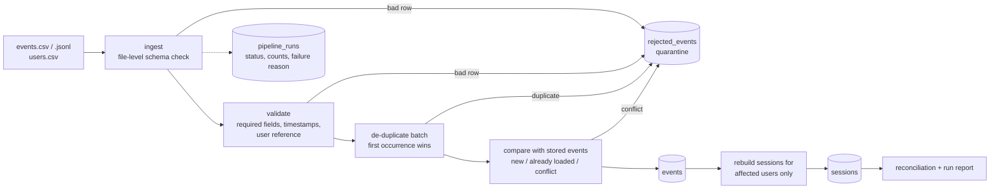

# Clickstream Sessionization Pipeline

Turns raw clickstream / application events into **user sessions** using event-time gaps, and does it
the way a client would need it done: out-of-order and duplicate events are handled, bad records are
quarantined with a reason, reruns are safe, and every run proves that its numbers add up.

* Python 3.9+ and SQLite, **standard library only** (no install needed to run it).
* 120 automated tests, a reproducible data generator with a separate answer key, a reconciliation report,
  and a measured performance run on 100,000 rows.

---

## 1. Quick start (Windows PowerShell; macOS/Linux commands are the same except activation)

Clone the repository from its published URL, then run these commands from the project directory:

```powershell
python -m venv .venv
.venv\Scripts\Activate.ps1          # macOS/Linux: source .venv/bin/activate
python -m pip install -e ".[test]"    # optional: installs the package and pytest
```

> If PowerShell blocks activation: `Set-ExecutionPolicy -Scope Process -ExecutionPolicy Bypass`, then activate again.
> You can also skip the virtual environment entirely; nothing needs installing.

**Run the tests** (works without pytest):

```powershell
python -m unittest discover -v
```

**Process the small sample** and check it against the answer key:

```powershell
python -m pipeline run --input data/sample/events.csv --users data/sample/users.csv --expected-dir data/expected/sample
python -m pipeline queries          # example business questions answered from the output
```

**Generate and process a large dataset (100,000 rows) and measure speed:**

```powershell
python -m pipeline generate --rows 100000 --out-dir data/large --expected-dir data/expected/large
python -m pipeline run --input data/large/events.csv --users data/large/users.csv --db out/large.db --expected-dir data/expected/large
python -m pipeline benchmark --rows 100000 --output docs/PERFORMANCE.md
```

**Prove reruns are safe** (second run loads nothing new, counts and sessions are unchanged):

```powershell
python -m pipeline run --input data/sample/events.csv --users data/sample/users.csv
python -m pipeline run --input data/sample/events.csv --users data/sample/users.csv
```

Outputs go to `out/` (SQLite database `out/sessions.db`, a markdown run report, `sessions.csv`, `rejected_events.csv`).
Example outputs from the sample are committed in [`docs/sample_output/`](docs/sample_output).

### Commands

| Command | Purpose |
|---|---|
| `python -m pipeline run --input FILE [FILE...] [--users users.csv] [--gap-minutes 30] [--db PATH] [--config config.json] [--max-reject-rate 0.2] [--expected-dir DIR]` | process files into sessions |
| `python -m pipeline generate --rows N --seed S [--format csv\|jsonl] [--gap-minutes 30]` | synthetic data + answer key |
| `python -m pipeline reconcile --db PATH [--expected-dir DIR]` | consistency checks on an existing database |
| `python -m pipeline queries --db PATH` | run `sql/sample_queries.sql` |
| `python -m pipeline benchmark --rows N` | timing per stage + optimisation experiment |

Exit codes: `0` success, `1` run failed, `2` bad arguments/config, `3` a reconciliation check failed.

---

## 2. What it does



All database changes of one run happen in **one transaction**: it is applied completely or not at all.

### Business rule (the core)

A user's events are ordered by `(event_time, event_id)`. A **new session starts when the gap since the previous
event is strictly greater than 30 minutes** (configurable). A gap of *exactly* 30:00 stays in the same session;
30:01 starts a new one. The gap is measured from the previous event, not from the session start, so a user who
clicks every 25 minutes for three hours has one long session.

### Data-quality rules (each rejected row gets exactly one reason, first rule broken wins)

| Reason | Meaning |
|---|---|
| `malformed_row` | wrong number of CSV fields, invalid JSON line, or nested JSON value |
| `missing_required_field` | `event_id`, `user_id` or `event_type` blank / `null` / `none` / `nan` / `n/a` |
| `missing_timestamp` | `event_time` blank or null-like |
| `invalid_timestamp` | not an ISO-8601 date-time (date-only, epoch numbers, impossible dates) or year outside 2000-2100 |
| `invalid_reference_key` | `user_id` is not in `users` (check active whenever users are loaded) |
| `duplicate_event` | same `event_id` and same content as an earlier row in the batch |
| `conflicting_duplicate_event` | same `event_id` but different content (in the batch or already stored); first version is kept |

A **file-level** problem (a required column missing, wrong file type, unreadable encoding) fails the run
with a clear `failure_reason` and loads nothing. See [docs/DATA_DICTIONARY.md](docs/DATA_DICTIONARY.md) for every table and column.

---

## 3. Idempotency, retry, restart and backfill

| Situation | Behaviour |
|---|---|
| **Rerun of the same file** | Events are keyed by `event_id`; identical events count as `already loaded` (not errors), no sessions are rebuilt, tables are unchanged. Each run still adds its own row in `pipeline_runs` (and its own rejects) as an audit trail. |
| **Crash / failure mid-run** | The transaction is rolled back, so no partial events or sessions exist. The run is recorded as `FAILED` with the reason; its rejects are kept for diagnosis. |
| **Retry** | Just run the same command again. Safe because of the two rows above. |
| **Late-arriving / out-of-order data** | New events are merged with stored history; sessions are rebuilt for the affected users only, so a late event can merge or extend sessions. Reported as `late_events`. |
| **Backfill of older data** | Same mechanism: load older files at any time; results equal what a chronological load would give. |
| **Changing the gap** | If stored sessions used a different gap, all users are rebuilt in the same run and a note is recorded. |
| **Concurrent runs** | A write lock is taken at start; a second writer waits up to 10s, then fails cleanly. |

---

## 4. Proof that it works

* **Unit and integration tests** (`tests/`): happy path, empty file, header-only, malformed rows, missing/null/invalid
  fields, duplicates, conflicting duplicates, schema change, invalid reference key, exact 30-minute boundary,
  sessions spanning midnight, identical timestamps, out-of-order input, late data merging sessions, backfill,
  rerun, partial failure + retry, quality gate, missing file, unsupported type, UTF-8 BOM, JSONL, column mapping.
* **Answer key** (`data/expected/`, kept separate from the input): the generator builds sessions first, so the
  correct sessions and the correct rejected lines are known *independently of the pipeline code*. Tests and the
  `--expected-dir` option compare the pipeline output to it exactly (sessions and rejects, on CSV and JSONL, several seeds).
* **Reconciliation** (`pipeline/reconcile.py`, run automatically after every `run`):
  rows read = rejected + inserted + already loaded; reject table matches the run counter; stored events = sum of
  session event counts; every event lies inside a session of its user; sessions of one user never overlap or sit
  closer than the gap; session fields are internally consistent; events reference known users.
* **Mutation check:** deliberately breaking the gap rule, de-duplication, gap-change rebuild and rollback each made the suite fail.

## 5. Performance

`python -m pipeline benchmark --rows 100000 --output docs/PERFORMANCE.md` records time per stage and a
rerun. [docs/PERFORMANCE.md](docs/PERFORMANCE.md) contains results measured on the machine used for this
submission; timings will vary across machines.

**Optimisation applied and measured:** after loading, sessions are rebuilt only for users that received new
events (in batches of 500 users using the `(user_id, event_ts, event_id)` index), instead of rebuilding everyone.
A late batch touching ~1% of users rebuilds roughly 100x fewer users, and a rerun rebuilds none.
Largest cost today is parsing/validating rows in Python; see next steps.

## 6. Repository layout

```
pipeline/            code: config, schema, ingest, validate, dedupe, sessionize, store, runner,
                     reconcile, report, datagen, benchmark, cli
sql/schema.sql       table definitions;  sql/sample_queries.sql  example analytics
tests/               unittest suite (also runs under pytest)
data/sample/         40-row starter input;  data/expected/sample/  its answer key
docs/                DATA_DICTIONARY, DECISIONS (trade-offs), AI_USAGE, PERFORMANCE, sample_output/
prompts/             full prompt history
config.json          example configuration
```

Naming: snake_case tables and columns; ISO-8601 UTC timestamps (`2026-01-01T10:00:00Z`) plus `*_ts` epoch
columns; deterministic IDs (`session_id = "ses_" + sha1(user_id|session_start)[:16]`); `run_id`
(`run_<UTC time>_<random>`), `source_file` and `source_row` on every event and reject.

## 7. Assumptions

* Events carry a unique `event_id`; the source is at-least-once delivery, so duplicates are expected.
* Timestamps without an offset are UTC. Sub-second precision is truncated to whole seconds.
* The first version of a duplicated `event_id` wins (in file order, then by earlier runs); later conflicting versions are rejected, never overwritten.
* A user in no `users` list is treated as an invalid reference only when a users list has been loaded.
* Row numbers are physical line numbers (CSV header = line 1).

## 8. Known limitations and next steps

* Batch only: a file is read into memory (fine for millions of rows, not billions). Next: chunked reading, then streaming.
* Validation is single-threaded Python; the dominant stage in the benchmark. Next: multiprocessing or a columnar engine (DuckDB/Polars).
* SQLite allows one writer at a time; a warehouse (Postgres/BigQuery) would replace `store.py`.
* `session_id` is derived from the session start, so a very late event that moves a session's start changes its ID (old row is replaced, never duplicated).
* No per-user timezone/device handling; events are sessionized per `user_id` only.
* Next steps: orchestration (Airflow/cron) wrapping `run`, alert on non-zero exit codes, dashboard on `pipeline_runs`.
